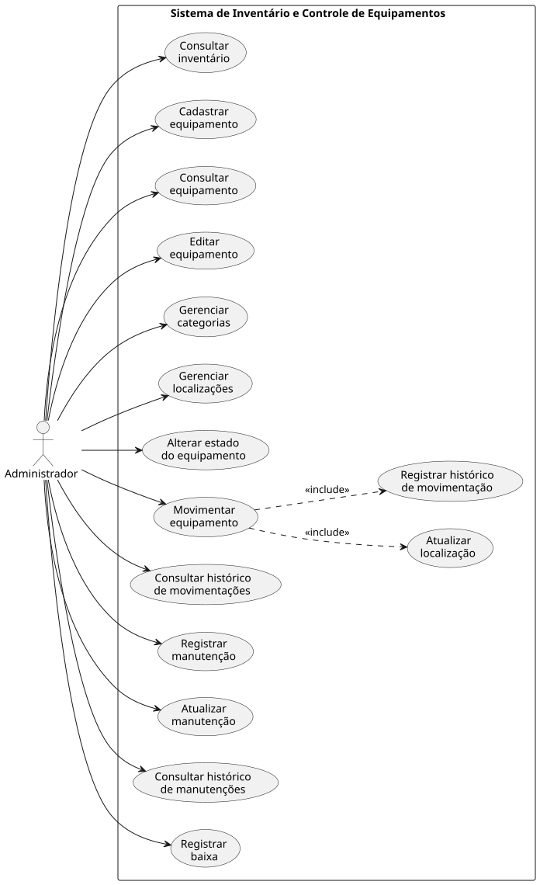
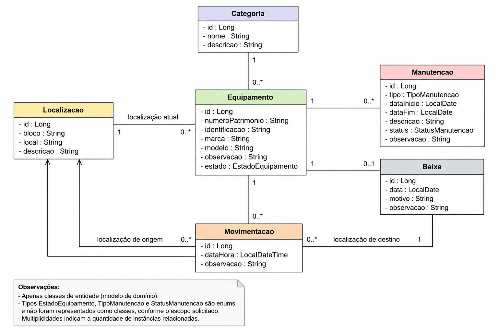

# Documentação do projeto

- [Como executar, testar e demonstrar](../README.md)
- [Definição inicial do projeto (PDF)](definicao-projeto.pdf)
- [Requisitos funcionais e não funcionais](requisitos/requisitos.md)
- [Arquitetura](arquitetura.md)
- [Plano original de implementação](plano-implementacao.md)
- [API REST e exemplos](api.md)
- [Modelo de domínio](modelo-dominio.md)

## Modelagem

### Casos de uso

[Fonte PlantUML](diagramas/casos-de-uso/use-case.puml)

### Classes

### Atividades

- [Cadastrar equipamento](diagramas/atividades/diagrama-atividade-cadastrar-equipamento.png)
- [Movimentar equipamento](diagramas/atividades/diagrama-atividade-movimentar-equipamento.png)
- [Registrar manutenção](diagramas/atividades/diagrama-atividade-registrar-manutencao.png)
